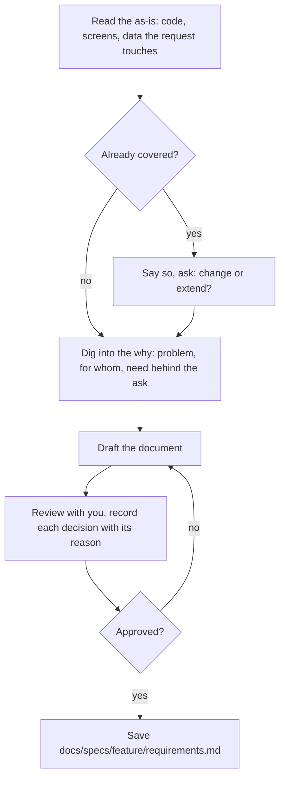
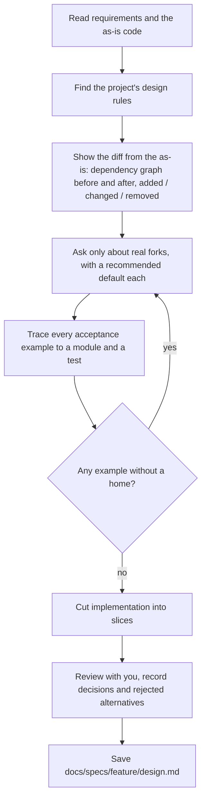
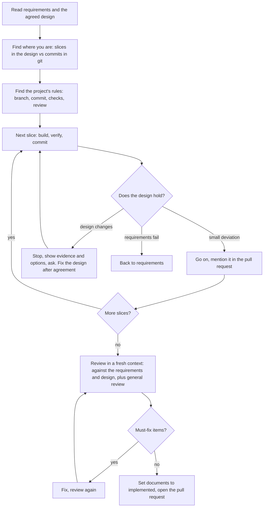

# sdf-skills

Structured Development Flow (sdf): agent skills for working through a feature with an AI agent, one agreed step at a time.

```
request → requirements → design → implement → pull request
              ▲             ▲          ▲             ▲
           you review    you review  review in     you review
                                     a fresh       and merge
                                     context
```

Each step produces a short document or a change that you review before the next step starts. The agent digs into the *why* with you, shows what changes against the current system, and proves the result against what you agreed.

## Skills

| Skill | Use it when | Produces |
| --- | --- | --- |
| `sdf-requirements` | You have a feature request. Digs into the why, checks the as-is, and agrees on the experience, scope, and acceptance examples | `docs/specs/<feature>/requirements.md` |
| `sdf-design` | Requirements are agreed. Agrees on the diff from the as-is, module boundaries, data shape, and how each acceptance example is satisfied | `docs/specs/<feature>/design.md` |
| `sdf-implement` | The design is agreed. Builds slice by slice (one commit each), reviews in a fresh context against the requirements and design, and opens a pull request | Commits and a pull request |

Run them in separate sessions if you like. The documents are the hand-off, and progress during implementation is readable from git.

## What each skill does

### sdf-requirements

Agree on what the user can do and why, not how it is built.



The document always has Why, Goal, Out of scope, Experience, Acceptance examples (including what must not happen), and Decisions. It adds a state transition diagram for stateful features, a data flow diagram per use case for external systems, and a throwaway UI sketch plus display rules for UI.

### sdf-design

Agree on where the current system changes and how, so implementation has no surprises.



Project rules (structure, interfaces, tests, migrations, UI) are found in `CLAUDE.md`, the rules directory, and the available skills. The project's rules win, and the design lists which ones it applied.

### sdf-implement

Build what the design says, in order, and prove it before asking you to review.



Progress lives in git (one commit per slice), so a compact or a new session can resume from the log. The review follows the project's own procedure when there is one; otherwise it reports must fix, needs clarification, or OK.

## Principles

- **Loosely coupled.** The skills do not depend on other skills. Where a project has its own rules for structure, tests, or review, the skills look for them and follow them. The project's rules win.
- **Agree, then record.** Decisions are written down with their reasons. After implementation the code is the source of truth; the documents stay as the record of what was agreed.
- **Thin.** Only what a reviewer needs to agree on is written. Details are left to implementation.
- **Stop when the plan breaks.** If implementation shows the design does not hold, the agent stops and asks instead of drifting.

## Install

With the GitHub CLI:

```bash
gh skill install syakoo/sdf-skills sdf-requirements --agent claude-code --scope project
gh skill install syakoo/sdf-skills sdf-design --agent claude-code --scope project
gh skill install syakoo/sdf-skills sdf-implement --agent claude-code --scope project
```

Or copy (or symlink) the skill directories into your project's `.claude/skills/`.

## Output location

Documents go to `docs/specs/<feature>/` by default. If your project's `CLAUDE.md` names another location for sdf documents, the skills use that.

## Status

Experimental. Tried end to end on one personal project so far.
